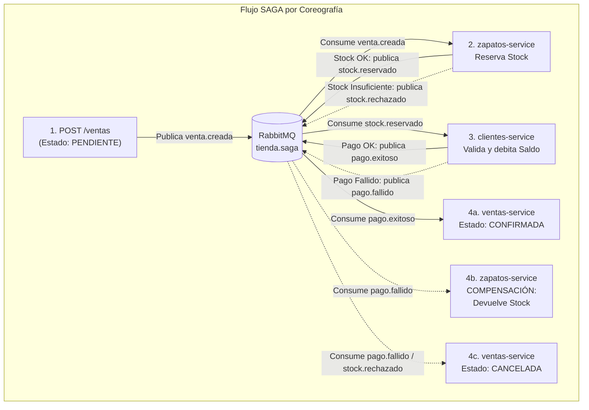

# Tienda de Zapatos - Arquitectura de Microservicios con Patrón SAGA (Coreografía)

Este proyecto es una demostración práctica de arquitectura de **Microservicios con el patrón "Database per Service"**, persistencia políglota y gestión de transacciones distribuidas mediante el **patrón SAGA por Coreografía** utilizando **RabbitMQ** como bus de mensajería (AMQP).

Está desarrollado en Python con **FastAPI**, **PostgreSQL**, **MongoDB** y **RabbitMQ**, orquestado con Docker Compose.

---

## 🏛️ Arquitectura del Sistema

El ecosistema se compone de 3 microservicios independientes y un Message Broker:

1. **Clientes Service** (`localhost:8001`)
   - **Base de datos:** PostgreSQL (`clientes-db`).
   - **Responsabilidad:** Gestión de clientes y saldo de compras. En la SAGA, debita el saldo o emite fallo si es insuficiente.
2. **Zapatos Service** (`localhost:8002`)
   - **Base de datos:** PostgreSQL (`zapatos-db`).
   - **Responsabilidad:** Inventario de calzado. En la SAGA, reserva stock (transacción local) y **ejecuta la compensación (rollback semántico)** devolviendo el stock si el pago falla.
3. **Ventas Service** (`localhost:8003`)
   - **Base de datos:** MongoDB (`ventas-db`).
   - **Responsabilidad:** Registro de ventas con estados (`PENDIENTE`, `CONFIRMADA`, `CANCELADA`) e inicio del flujo SAGA.
4. **RabbitMQ** (`localhost:5672` / Panel web: `localhost:15672`)
   - **Responsabilidad:** Message Broker asíncrono para intercambio de eventos distribuidos (`tienda.saga`).

---

## 🔄 Flujo del Patrón SAGA por Coreografía

No existe un orquestador central; cada microservicio reacciona a eventos en RabbitMQ y emite el siguiente paso o su compensación:



---

## 🚀 Cómo Ejecutar el Proyecto

Asegúrate de tener Docker y Docker Compose instalados y en ejecución. En la terminal de la raíz del proyecto:

```bash
docker compose up --build
```

### Puertos Disponibles:
- **Zapatos Service:** `http://localhost:8002` (Docs: `/docs`)
- **Clientes Service:** `http://localhost:8001` (Docs: `/docs`)
- **Ventas Service:** `http://localhost:8003` (Docs: `/docs`)
- **RabbitMQ Management Dashboard:** `http://localhost:15672` (Usuario: `admin`, Contraseña: `admin123`)

---

## 🧪 Pruebas del Patrón SAGA (Paso a Paso)

### Preparación Inicial

#### 1. Crear un Zapato con Stock
* **URL:** `POST http://localhost:8002/zapatos`
* **JSON:**
```json
{
  "marca": "Nike Air Force",
  "talla": 40,
  "color": "Blanco",
  "precio": 250000.0,
  "cantidad_disponible": 10
}
```
*(Supongamos que devuelve el `id_zapato: 1` con 10 unidades).*

#### 2. Registrar un Cliente con Saldo
* **URL:** `POST http://localhost:8001/clientes`
* **JSON:**
```json
{
  "nombre": "Samuel L.",
  "email": "samuel@ejemplo.com",
  "telefono": "3000000000",
  "saldo": 500000.0
}
```
*(Supongamos que devuelve el `id: 1` con $500,000 de saldo).*

---

### Escenario A: Camino Feliz (Happy Path - Consistencia Eventual)

El cliente tiene saldo suficiente ($500,000) y el zapato tiene stock (10 unidades).

1. **Crear la Venta:**
   * **URL:** `POST http://localhost:8003/ventas`
   * **JSON:**
   ```json
   {
     "id_cliente": 1,
     "id_zapato": 1,
     "cantidad": 1
   }
   ```
   *Respuesta inmediata (HTTP 202):*
   ```json
   {
     "id": "64bc...",
     "id_cliente": 1,
     "id_zapato": 1,
     "cantidad": 1,
     "estado": "PENDIENTE",
     "motivo_cancelacion": null
   }
   ```

2. **Verificar el resultado:**
   * Consulta la venta: `GET http://localhost:8003/ventas` -> `estado: "CONFIRMADA"`.
   * Consulta el zapato: `GET http://localhost:8002/zapatos/1` -> `cantidad_disponible: 9` (descontó 1).
   * Consulta el cliente: `GET http://localhost:8001/clientes/1` -> `saldo: 250000.0` (debitó $250,000).

---

### Escenario B: Compensación SAGA (Rollback Semántico por Saldo Insuficiente)

Demuestra cómo se revierte un paso ya persistido (el descuento de stock) porque el siguiente microservicio falló.

1. **Registrar un Cliente sin dinero suficiente:**
   * **URL:** `POST http://localhost:8001/clientes`
   * **JSON:**
   ```json
   {
     "nombre": "Carlos Pobre",
     "email": "carlos@ejemplo.com",
     "telefono": "3111111111",
     "saldo": 50000.0
   }
   ```
   *(Cliente con ID `2`, saldo $50,000. El zapato vale $250,000).*

2. **Intentar la compra:**
   * **URL:** `POST http://localhost:8003/ventas`
   * **JSON:**
   ```json
   {
     "id_cliente": 2,
     "id_zapato": 1,
     "cantidad": 1
   }
   ```

3. **¿Qué sucede en segundo plano por RabbitMQ?**
   - `zapatos-service` descuenta el stock de 9 a 8 y emite `stock.reservado` (**Paso 1 confirmado**).
   - `clientes-service` recibe `stock.reservado`, comprueba que $50,000 < $250,000 y emite `pago.fallido`.
   - `zapatos-service` recibe `pago.fallido` y ejecuta la **TRANSACCIÓN COMPENSATORIA**: suma nuevamente 1 al stock (vuelve a 9) y emite `stock.compensado`.
   - `ventas-service` recibe `pago.fallido` y marca la venta como `CANCELADA`.

4. **Verificación:**
   * Consulta la venta: `GET http://localhost:8003/ventas` -> `estado: "CANCELADA"`, `motivo_cancelacion: "Saldo insuficiente..."`.
   * Consulta el zapato: `GET http://localhost:8002/zapatos/1` -> `cantidad_disponible: 9` (**¡El inventario se restauró intacto gracias a la compensación SAGA!**).
   * Consulta el cliente: `GET http://localhost:8001/clientes/2` -> `saldo: 50000.0` (no se debitó nada).

---

### Escenario C: Fallo Temprano por Stock Insuficiente

Si un zapato tiene `cantidad_disponible: 0` y se intenta comprar:
1. `ventas-service` crea la venta `PENDIENTE` y emite `venta.creada`.
2. `zapatos-service` detecta falta de existencias y emite `stock.rechazado`.
3. `ventas-service` pasa la venta a `CANCELADA` con motivo `"Stock insuficiente"`.
4. `clientes-service` nunca llega a debitar saldo.
