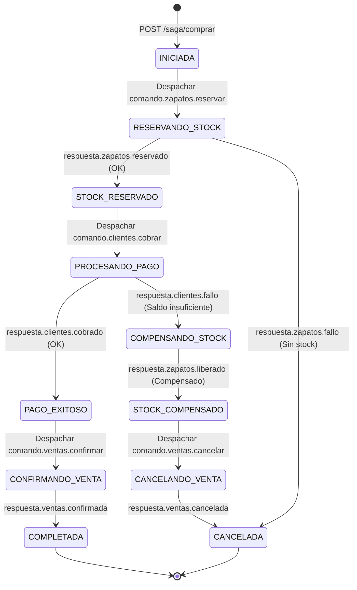
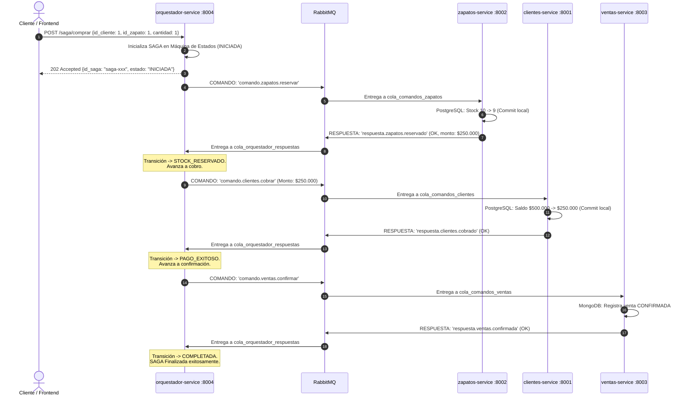
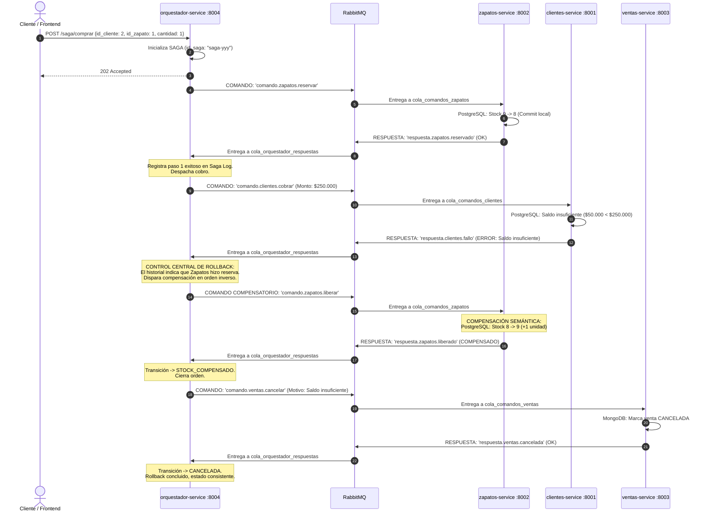

# Diagramación de la Arquitectura - Patrón SAGA (Orquestación)

Esta documentación detalla la arquitectura del sistema **Tiendazapatos** implementando el patrón **SAGA por Orquestación** mediante un **Orquestador Central (State Machine)**, mensajería orientada a **Comandos y Respuestas con RabbitMQ**, y persistencia políglota bajo el principio **Database per Service**.

---

## 1. Arquitectura General y Director Central

A diferencia de la coreografía donde los servicios reaccionan de manera reactiva y distribuida a eventos globales, en la **Orquestación** existe un director central: el `orquestador-service`. Este servicio modela una **Máquina de Estados Finita (FSM)** y conoce la totalidad del flujo del proceso de negocio:

```mermaid
flowchart TB
    Client[Cliente / Frontend / Swagger]

    subgraph DOCKER["Ecosistema Docker Compose"]
        subgraph ORCH["Director Central de la Transacción"]
            ORQ["orquestador-service<br/>FastAPI :8004<br/>(Máquina de Estados / Saga Log)"]
        end

        subgraph BROKER["Bus de Mensajería (RabbitMQ :5672 / :15672)"]
            EX["Exchange: tienda.saga.orquestada (Topic)"]
            Q_ORQ["cola_orquestador_respuestas"]
            Q_ZAP["cola_comandos_zapatos"]
            Q_CLI["cola_comandos_clientes"]
            Q_VEN["cola_comandos_ventas"]
        end

        subgraph S_ZAPATOS["Microservicio de Zapatos"]
            ZS["zapatos-service<br/>FastAPI :8002"]
            ZD[("zapatos-db<br/>PostgreSQL")]
            ZS -->|SQLAlchemy| ZD
        end

        subgraph S_CLIENTES["Microservicio de Clientes"]
            CS["clientes-service<br/>FastAPI :8001"]
            CD[("clientes-db<br/>PostgreSQL")]
            CS -->|SQLAlchemy| CD
        end

        subgraph S_VENTAS["Microservicio de Ventas"]
            VS["ventas-service<br/>FastAPI :8003"]
            VD[("ventas-db<br/>MongoDB")]
            VS -->|PyMongo| VD
        end
    end

    Client -->|POST /saga/comprar (HTTP 202)| ORQ

    %% Orquestador despacha comandos
    ORQ ==>|1. Publica Comandos| EX
    EX -->|comando.zapatos.*| Q_ZAP --> ZS
    EX -->|comando.clientes.*| Q_CLI --> CS
    EX -->|comando.ventas.*| Q_VEN --> VS

    %% Participantes responden al orquestador
    ZS ==>|2. respuesta.zapatos.*| EX
    CS ==>|2. respuesta.clientes.*| EX
    VS ==>|2. respuesta.ventas.*| EX
    EX --> Q_ORQ ==>|3. Notifica Respuesta| ORQ
```

---

## 2. Componentes y Responsabilidades

| Componente | Tecnología | Puerto | Rol en la SAGA Orquestada |
|---|---|---:|---|
| `orquestador-service` | FastAPI + Pika | 8004 | **Director Central:** Mantiene la máquina de estados, el registro de auditoría (*Saga Execution Log*), despacha comandos directos y orquesta compensaciones. |
| `zapatos-service` | FastAPI + SQLAlchemy | 8002 | **Participante:** Ejecuta `comando.zapatos.reservar` (resta inventario) y la compensación `comando.zapatos.liberar` (restituye inventario). Responde directamente al orquestador. |
| `zapatos-db` | PostgreSQL | Interno | Persistencia relacional de calzado y stock disponible. |
| `clientes-service` | FastAPI + SQLAlchemy | 8001 | **Participante:** Ejecuta `comando.clientes.cobrar` (debitando saldo). Responde OK o Fallo (Saldo insuficiente) directamente al orquestador. |
| `clientes-db` | PostgreSQL | Interno | Persistencia relacional de clientes y saldos monetarios. |
| `ventas-service` | FastAPI + PyMongo | 8003 | **Participante:** Registra la orden y ejecuta `comando.ventas.confirmar` o `comando.ventas.cancelar` según la directriz final del orquestador. |
| `ventas-db` | MongoDB | Interno | Persistencia documental de recibos y auditoría de pedidos. |
| `rabbitmq` | RabbitMQ Management | 5672 / 15672 | Bus AMQP que desacopla la comunicación punto a punto de comandos y respuestas mediante colas dedicadas. |

---

## 3. Máquina de Estados del Orquestador

El orquestador gestiona el ciclo de vida de cada transacción distribuida como una máquina de estados determinista:



---

## 4. Diagrama de Secuencia: Caso Práctico 1 — Camino Feliz (Éxito)

Cliente **Samuel L.** ($500.000 de saldo) compra un zapato Nike Air Force ($250.000):



---

## 5. Diagrama de Secuencia: Caso Práctico 2 — Fallo y Rollback Semántico

Cliente **Carlos Pobre** ($50.000 de saldo) intenta comprar zapato de $250.000:



---

## 6. Cuadro Comparativo: Coreografía vs. Orquestación

| Aspecto | SAGA por Coreografía | SAGA por Orquestación (Este Proyecto) |
|---|---|---|
| **Control del Flujo** | Descentralizado; cada microservicio reacciona a eventos de otros. | **Centralizado**; el Orquestador es el único que conoce el mapa completo. |
| **Tipo de Mensajería** | **Eventos de Dominio** broadcast (`venta.creada`, `stock.reservado`). | **Comandos Directos y Respuestas** (`comando.*` y `respuesta.*`). |
| **Complejidad en los Servicios** | Alta; cada servicio debe conocer qué eventos escuchar y cuándo compensar. | **Baja**; los servicios solo ejecutan instrucciones simples y reportan el resultado. |
| **Rollback Semántico** | Las compensaciones están dispersas en múltiples servicios (*cascada reactiva*). | **Unificado**; el Orquestador decide qué, cuándo y en qué orden compensar. |
| **Visibilidad y Monitoreo** | Difícil de rastrear sin tracing distribuido (OpenTelemetry / Jaeger). | **Inmediata**; el estado de cada transacción está disponible en `GET /saga/{id_saga}`. |
| **Punto Único de Lógica** | No hay; la lógica de negocio distribuida está distribuida. | El Orquestador concentra las reglas de coordinación de la transacción. |
