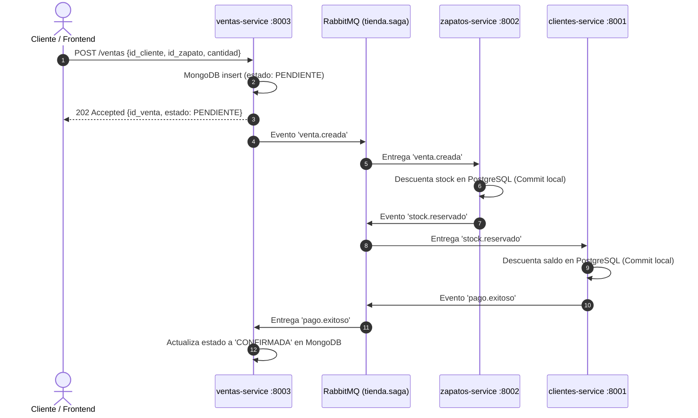
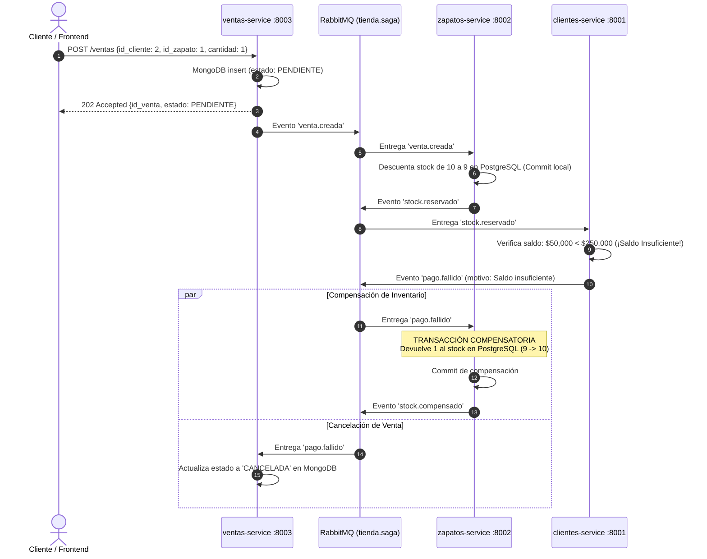

# Diagramación de la arquitectura - Patrón SAGA (Coreografía)

Esta documentación representa la arquitectura del repositorio **Tiendazapatos** implementando el patrón **SAGA por Coreografía** con **RabbitMQ**, base de datos por servicio (**Database per Service**) y persistencia políglota.

---

## 1. Arquitectura General y Broker de Mensajería

El proyecto utiliza microservicios desacoplados donde cada servicio administra su propia base de datos y se comunican asíncronamente a través de eventos usando **RabbitMQ (AMQP)**:

```mermaid
flowchart TB
    Client[Cliente / Postman / Frontend]

    subgraph DOCKER["Ecosistema Docker Compose"]
        subgraph BROKER["Bus de Mensajería"]
            RMQ[("RabbitMQ\nExchange: tienda.saga (Topic)\nPuertos: 5672 / 15672")]
        end

        subgraph S_VENTAS["Microservicio de Ventas"]
            VS["ventas-service<br/>FastAPI :8003"]
            VD[("ventas-db<br/>MongoDB")]
            VS -->|PyMongo| VD
        end

        subgraph S_ZAPATOS["Microservicio de Zapatos"]
            ZS["zapatos-service<br/>FastAPI :8002"]
            ZD[("zapatos-db<br/>PostgreSQL")]
            ZS -->|SQLAlchemy| ZD
        end

        subgraph S_CLIENTES["Microservicio de Clientes"]
            CS["clientes-service<br/>FastAPI :8001"]
            CD[("clientes-db<br/>PostgreSQL")]
            CS -->|SQLAlchemy| CD
        end
    end

    Client -->|POST /ventas (HTTP)| VS
    Client -->|POST /zapatos (HTTP)| ZS
    Client -->|POST /clientes (HTTP)| CS

    VS <==>|AMQP: venta.creada / pago.exitoso / cancelaciones| RMQ
    ZS <==>|AMQP: stock.reservado / compensación de stock| RMQ
    CS <==>|AMQP: debito de saldo / pago.fallido| RMQ

    VS -.->|HTTP GET composición de lectura| CS
    VS -.->|HTTP GET composición de lectura| ZS
```

---

## 2. Componentes y Responsabilidades

| Componente | Tecnología | Puerto | Rol en la SAGA |
|---|---|---:|---|
| `ventas-service` | FastAPI + PyMongo | 8003 | Inicia la transacción distribuida con estado `PENDIENTE`. Concluye a `CONFIRMADA` o `CANCELADA`. |
| `ventas-db` | MongoDB | Interno | Persistencia documental de las ventas y su estado en la SAGA. |
| `zapatos-service` | FastAPI + SQLAlchemy | 8002 | Valida y reserva stock (decrementa `cantidad_disponible`). Ejecuta **compensación semántica** (restituye stock si el pago falla). |
| `zapatos-db` | PostgreSQL | Interno | Persistencia relacional de calzado e inventario. |
| `clientes-service` | FastAPI + SQLAlchemy | 8001 | Valida la existencia del cliente y descuenta `saldo`. Si no alcanza, emite `pago.fallido`. |
| `clientes-db` | PostgreSQL | Interno | Persistencia relacional de clientes y saldos. |
| `rabbitmq` | RabbitMQ 3 Management | 5672 / 15672 | Bus de mensajería AMQP y panel de monitoreo visual. |

---

## 3. Diagrama de Secuencia: Transacción Exitosa (Happy Path)



---

## 4. Diagrama de Secuencia: Transacción con Compensación (Rollback Semántico)

Cuando el cliente no cuenta con saldo suficiente, la reserva de stock que ya fue confirmada (committed) en `zapatos-db` no se puede deshacer con un `ROLLBACK` SQL tradicional, por lo que se ejecuta una **transacción de compensación**:



---

## 5. Diseño del Bus de Mensajería (RabbitMQ Topic Exchange)

* **Exchange:** `tienda.saga` (Tipo `topic`, durable: true)

| Cola | Routing Keys Suscritas | Propósito |
|---|---|---|
| `cola_zapatos` | `venta.creada`, `pago.fallido` | Reserva de stock inicial y compensación de stock ante fallo en pago. |
| `cola_clientes` | `stock.reservado` | Validación del cliente y cobro/débito de saldo. |
| `cola_ventas` | `pago.exitoso`, `stock.rechazado`, `pago.fallido` | Actualización del estado terminal de la orden en MongoDB (`CONFIRMADA` o `CANCELADA`). |
